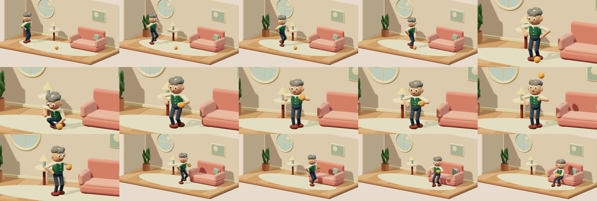

# One Small Break — 3D clay animation trial

[Download the 15-second MP4](clay-animation-15s.mp4)

An articulated gray-haired character in a green waistcoat walks, squats to pick up a ball, lifts and inspects it, tosses/catches it, walks to the sofa and sits. This is rendered Three.js geometry, with joint movement and hand/prop interaction.

**File:** 1920×1080, 15 seconds, 30 fps, H.264/yuv420p + AAC, 450 fully decoded frames. Clay posing is intentionally authored at 12 Hz. Sound is original local synthesis.

Engine and reproducible commands: [engines/hyperframes-clay3d](../../engines/hyperframes-clay3d/). Source/license pin: [third_party/hyperframes](../../third_party/hyperframes/). Visual/technical findings and the optional registry connection limitation: [REVIEW.md](../../engines/hyperframes-clay3d/REVIEW.md).

Reports include the actual video probe/decoded-frame comparison, browser motion audit, HyperFrames check, npm audit, dependency doctor and render execution. `SHA256SUMS` identifies these delivery artifacts.

No paid API, HeyGen service, credit, login or YouTube upload was used. Existing Stickman Video Director and all twelve YouTube Agent skills were preserved.
